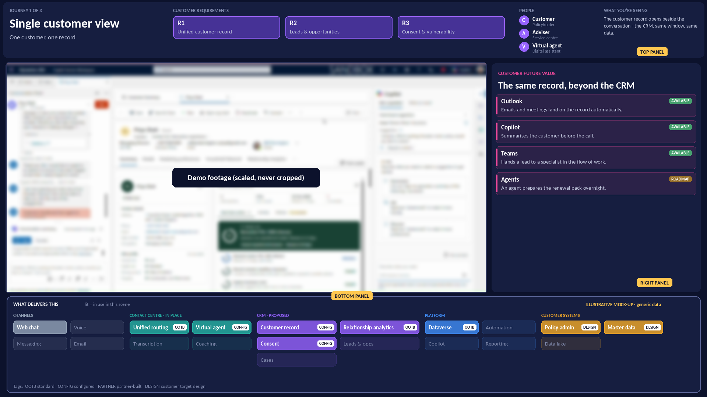

# Demo video production

Version 1.5.0 (23 Nov 2026)

Long screen recordings become short narrated demos. This skill exists to get there in **one
pass** rather than a dozen. The expensive mistake is cutting before the brief is agreed — every
re-cut invalidates the narration timing, and every re-render costs minutes.

**Requirements.** Runs in Microsoft 365 Copilot (Cowork) with code execution. Uses ffmpeg and
Python 3 with numpy and Pillow. Generated narration needs the agent's audio-generation tool
(`host-PodcastGenerate`); where that tool is unavailable, fall back to the Clipchamp route in
step 5. Motion graphics (step 3e, `scripts/motion.py`) need nothing beyond Pillow, numpy and
ffmpeg - no browser engine.

## The rule that saves the most time

**Never render anything until the Brief is agreed.** Audit the footage, write the Brief, get one
round of amendments, then cut once. A cut produced before the Brief will be rebuilt three times.

## Before you start: re-read this skill from disk

**Every time this skill is applied, re-read the PUBLISHED file before doing anything else.** Do
not work from the copy loaded when the session began. This skill is edited from many tasks, often
on the same day, and the copy you were handed can be hours out of date — missing rules that were
added since, including rules that would have changed how you cut this film.

Read the published `SKILL.md` and `scripts/fx_recipes.md` from disk at the start of the job, and
again immediately before any edit to them.

## Editing this skill without destroying someone else's work

A task does not reload the skill before writing to it: it publishes the copy it has been holding.
If another task published in the meantime, that write silently overwrites their work — no
conflict, no warning, no merge. This has cost four separate losses, one of them fourteen whole
sections including an entire numbered step. Treat every publish as a merge, not a save.

**The protocol, in order:**

1. **Diff before you write.** Compare the published file against the copy you hold. If the
   published file contains anything you do not, you are about to delete it.
2. **Merge, never overwrite.** Take the PUBLISHED file as your base and re-apply your own changes
   onto it. Never take your held copy as the base. Verify BOTH sets afterwards — your markers and
   theirs.
3. **Size only ever grows.** Every loss so far had the same signature: the file shrank while the
   edit was supposedly adding something. A smaller file after an edit means something was dropped.
   Stop and diff.
4. **Keep a marker list and check it after publishing.** One distinctive string per section. Check
   all of them against the PUBLISHED file, not your draft. This is what catches a silent
   truncation.
5. **Publish the whole file, never edit in place.** Prepare the complete file, then publish it as
   a single wholesale copy. In-place string editing has silently truncated this skill twice on its
   own, independently of the concurrency problem.
6. **Sequence skill edits; do not parallelise them.** If two tasks will both teach the skill
   something, let one finish and publish before the other begins. A merge is only possible while
   both versions still exist.

**Do the update as a deliberate step at the END of a job**, not mid-flight, and state plainly what
was checked. If a merge was needed, say so and name what came from where.

## Workflow

### 0. Qualify the job before asking for anything else

Three answers determine the whole editing path: what the source is, how the film will be used, and
who it is for. Ask those three first, in one message. Everything else follows from them - asking
for inputs before you have them produces a list the colleague cannot act on and a Brief built on
the wrong assumptions.

Footage is still the only hard requirement. Missing answers do not block the audit: draft with
neutral defaults, mark them clearly in the Brief, and correct them at the amendment step.

**Question 1 - what is the source?**

| Answer | What it means | Where to go |
|---|---|---|
| Raw screen recording | No commentary, or commentary that was never meant to ship | Step 1, full discovery pass |
| Teams / live session recording | Delivered to an audience, has a transcript, has a participant rail | Step 1a - the transcript IS the scene map, and the consent gate applies |
| Already-edited film | It has its own zooms, titles, captions, maybe a presenter on camera | Step 2, "When the source is ALREADY an edited film" - add no moves, cap the ramps |

Ask this explicitly rather than inferring it from the file. A polished film and a raw capture are
opened the same way and edited completely differently.

**Question 2 - how will the film be used?**

| Use | What changes | Deliverables |
|---|---|---|
| Sent to a customer (email, portal, follow-up) | Watched alone, often at desk volume or muted | Narrated master plus a captioned version; it must stand on its own |
| Shown on a Teams call | The presenter narrates live and shares screen | Silent, or a low music bed - no voiceover competing with them; shorter is better |
| Presented on stage at an event | Large screen, live presenter, venue PA | Step 3d - three versions on identical picture and pacing |
| Playing unattended (booth, foyer loop, kiosk) | No one to explain it, often no audible sound | Captions carry the whole story; check the last frame cuts back to the first cleanly |
| Internal enablement or training | Watched deliberately, paused, rewound | Longer runtime is acceptable; keep the detail a customer film would cut |

This decides the DELIVERABLE SET, not just the runtime. It is the cheapest thing to get right at
the start and the most expensive to change once the narration is recorded.

**Question 3 - who is it for, and whose brand does it carry?**

| Branding supplied | What it gives you |
|---|---|
| A customer website | Palette, typeface family and heading tone - enough on its own |
| A logo file | The end card, and a corner watermark if wanted |
| Brand guidelines, a deck, a pitch pack | Palette and type rules read rather than sampled by eye |
| Nothing | The neutral default - say which accent colour you picked |

Any one of these is enough; see step 2 for how each is applied. **Personas** are the other half of
this answer: name and role for EACH person the demo follows, and where each one appears. Ask for a
**full-frame photograph** of each - a real photo of them at work, which makes a far stronger
persona card than a headshot inset into a panel. Say that any aspect ratio is fine and that an
off-centre subject is fine too, because the push is aimed at the face wherever it sits. A headshot
still works, and neither is required - see "Persona images" in step 1 for where the face comes from
if they have none. Ask explicitly whether the demo hands off between people; it often does, and discovering
a second persona after the cut means re-badging every affected scene.

**Question 4 - does the film need to show what is "under the bonnet"? Default: no.** Offer the
optional panel layer (step 2g) in one line with the mock-up, and only when the film is meant to
explain the solution as well as show it - a technical or architecture audience, or customer
feedback along the lines of "where is the CRM in this?". If they want it, ask which of the three
panels (top, bottom, right) and for the collateral each one needs. If not, record it as OFF and
move on.

**Then request the inputs the answers imply - in that order, not all at once.** A colleague handed a
ten-item checklist supplies the easy three and stalls. Ask for what the next step actually needs,
and ask for the rest when you reach it:

1. **The footage itself** - blocking; nothing proceeds without it
2. **The transcript**, if it is a Teams recording or the capture has commentary - step 1a; for a
   screen capture, only once `speech.py` says there IS speech
3. **Persona details** - name, role, organisation, and a headshot if they have one - once the scene
   map shows who appears and where
4. **Branding** - website, logo or guidelines - before the Brief, because it shapes every card and
   overlay
5. **The value summary lines and the closing line** - at the Brief, drafted from the footage for
   them to correct rather than asked for cold
6. **B-roll** - only if the shape of the film calls for it, and always with the provenance and
   clearance question (see step 3c). Ask what they have rather than suggesting a subject; the
   film's setting comes from the customer's world, not from a default
7. **Solution collateral** - only if "under the bonnet" panels are ON (step 2g): architecture
   diagram or deck, requirements or epics list, and the productivity / roadmap position. Before
   the Brief, because it decides what each panel can claim
8. **Narration audio** - last, after the cut is agreed, as one file per scene. The AGENT
   generates it (voice Ada, 0.85x with added pauses - step 5); the user supplies recorded audio
   only if they prefer a human read or their own voice

**Target runtime** defaults to 3-4 minutes, but Question 2's answer usually sets it: a stage film
wants under two minutes, an enablement film can run five.

### 1. Ingest and audit (no rendering yet)

```bash
ffmpeg -i SOURCE.mp4 2>&1 | grep -E "Duration|Stream"          # length, resolution, audio?
ffmpeg -i SOURCE.mp4 -af volumedetect -f null - 2>&1 | grep mean_volume   # -91dB = silent
mkdir -p working/scan && ffmpeg -loglevel error -i SOURCE.mp4 \
  -vf "fps=1/20,scale=960:-1" -q:v 5 working/scan/f_%03d.jpg
```

**Source audio is discarded.** Every segment is cut with `-an` and the film is narrated fresh,
so any commentary already on the recording is lost - cutting and speed-ramping would break it
anyway. That does not make the commentary worthless: what the presenter chose to say is the best
available evidence of what matters in the footage.

**Clipchamp captures arrive as `.webm` - convert before you probe or cut.** They carry no
duration in the header (`Duration: N/A`) and a variable frame rate (one measured at 30.3fps
nominal, 60 tbr), so seeks and segment lengths drift. Re-encode once to constant 30fps .mp4 and
work only from that copy: `python scripts/motion.py webm IN.webm OUT.mp4`. A few seconds per
minute of footage. Do not ask the user to re-export.

**Detect speech before the Brief, not after.**

```bash
python scripts/speech.py SOURCE.mp4
# {'speech': True, 'mean_db': -23.8, 'coverage': 0.83, 'windows': [[1.2, 14.8], ...]}
```

This answers *is someone talking, and when* - there is no speech-to-text in this environment, so
it cannot answer *what they said*. If `speech` is true, say what was found and ask one question:
**should the commentary be taken into account?** If yes, ask them to open the recording in
**Clipchamp**, turn on captions and export the transcript (Word or .txt) - then compare it against
the scene map and surface the differences in the Brief:

- points the presenter stressed that the scene map treats as filler
- anything emphasised inside a section marked **cut** or **speed up** - name it and ask:
  "you spend 40s on the credit memo at 4:10 and call it the heart of the demo, but that section is
  marked for compression - keep it at full length?"
- claims, figures or customer names spoken aloud that must appear in the narration or be removed

If `speech` is false (a mean below about -70dB is a silent track), say so and move on - do not ask.

**Persona images.** In priority order:

1. **Extract from the footage.** Recordings very often already contain the persona - a closing
   photo slide, a Teams participant tile, a stock banner inside the customer's own deck. Sample
   frames, look at them, crop the face, iterate. This is manual visual work: there is **no
   face-detection library** here (no cv2, dlib, mediapipe or face_recognition) and none can be
   installed. It is still the best option, because the badge then matches the person on screen.
2. **Ask the colleague** for a headshot - theirs, the persona's, or a licensed stock image.
3. **Generate one** with the image tool. Original, no licensing question, and consistent across a
   set of personas if the same style descriptor is repeated verbatim in each prompt.

Do **not** take persona photos from an image web search: those results are not reliably licensed
for customer-facing material. Recipes and a tested prompt are in `scripts/fx_recipes.md` s11.

For footage over ~20 minutes also sample at `fps=1` into a second folder — the 1-per-20s pass
finds the scenes, the 1-per-second pass finds exact cut points. Detect app switches:

```bash
python - <<'PY'
from PIL import Image; import numpy as np, glob
prev=None
for i,f in enumerate(sorted(glob.glob('working/scan/f_*.jpg'))):
    a=np.asarray(Image.open(f).convert('L').resize((96,54)),dtype=float)
    if prev is not None and np.abs(a-prev).mean()>10: print(f"{i*20//60}:{i*20%60:02d}")
    prev=a
PY
```

View the sampled frames. Identify: what application, what the agent/user is doing, and whether
the screen shows **English prose** (keep) or **tool names and file paths** (compress).

### 1a. Teams meeting recordings - a different ingest, and a better one

A demo delivered live to a customer is often the best source you will get: it is real, it is
paced for an audience, and it comes with a **transcript**. It also needs three things a screen
capture does not.

**Getting the file.** A Teams recap link carries the drive and item ids; the recording and the
transcript are fetched by different routes, and the transcript frequently works when the video
does not - so fetch the transcript first and start work with it.

**The download-succeeds-but-will-not-open trap.** A labelled or very large recording reports a
SUCCESSFUL download with the correct byte count, then fails every read with an I/O error, while
other files in the same folder read fine. Do not diagnose this as permissions and do not keep
retrying: ask the colleague to open the recording in **Clipchamp and export it**. The re-encode
produces clean bytes and resolves it. (Measured: three failed routes - drive item, file URL, and
a re-upload of the same bytes - then a Clipchamp export opened first time.)

**The transcript IS the scene map.** It arrives timestamped and speaker-attributed, so it
replaces the discovery pass rather than supplementing it. Build the scene map from the transcript
first, then sample frames to CONFIRM what is on screen at each timecode. This inverts the order
used for silent screen captures, and it is much faster.

**Classify every segment four ways, not two:**

| Verdict | Signal | Action |
|---|---|---|
| **Demo** | the presenter narrating their own screen | keep, at speed |
| **Value** | anyone saying why it matters - including in Q&A | keep; harvest for narration and the end card |
| **Dead air** | "while that's running", "still thinking", silence | cut hard |
| **Meeting** | roll call, hands up, chat management, sign-off | cut |

**The best value lines hide in the Q&A.** In a live session the presenter is busy driving; it is
the questions that force them to articulate the point. Two of the strongest lines in a recent
film came from colleagues answering each other, and a naive "cut the chatter" rule would have
thrown both away. Read the Q&A for content before cutting it as meeting noise, and surface the
Value-versus-Meeting judgement in the Brief rather than deciding it silently.

**Crop to the shared content - measure it, never guess.** A Teams recording is a composite of the
shared screen plus a participant rail. Find the share window and the shared region from the
footage (`scripts/fx_recipes.md` s12); a recent 1920x1080 recording measured 1670x944 at offset
0,46, which is within a whisker of 16:9 and rescales to full frame with no rail and no
letterboxing. Report the measured rectangle in the Brief.

**Scan the whole recording for on-screen failures.** Live demos break. Colour-match the error
icon across every second rather than eyeballing sampled frames - it finds banners and toasts that
a 1-per-20s scan misses entirely, and it gives exact in/out points. **Cut short failures rather
than blurring them**: a blur leaves a grey smear that draws the eye straight to the thing being
hidden, and a five-second failure window is almost always dead time anyway.

**Consent and clearance gate - before any render.** A live customer or internal session contains
named colleagues, customer names, candid remarks and product feedback that is fine internally and
a liability in a customer-facing film. List in the Brief: who appears on camera, who is quoted,
which customers are named, and anything said that should not leave the room. Get that list
confirmed explicitly.

### 2. Write the Brief — the deliverable of this step is a document, not a video

The Brief contains all seven sections below (g is usually just "OFF" plus the mock-up). Present it and ask for amendments **once**.

**a. Scene map.** Every section of source with in/out timecodes, what happens, and a verdict:
keep at full speed / compress / cut. Name the dead time explicitly — loading spinners, failed
attempts, tooling errors. On real footage this is often 30-50% of the runtime.

**b. Persona and branding decisions.** Which persona, and whose brand the film carries. Settle
this **before** cutting: brand changes can force a re-record, and finding that out after the
edit wastes the whole pass.

Ask what the user has, and use it:

| Supplied | What to do with it |
|---|---|
| A customer website | Fetch it. Take the palette, the typeface family and the tone of the headings; use them for overlays, badges and the end card so the film looks like it belongs to that customer |
| A logo file | Place it in the end card and, if wanted, a corner watermark. Never stretch it - scale one dimension and let the other follow. Leave clear space around it |
| Brand guidelines, a deck, a pitch pack | Read the palette and type rules from it rather than sampling screenshots by eye |
| Nothing | Use the neutral default: dark scrim, white text, one accent colour, and say which accent you picked |

**Brand going IN is cheap; brand coming OUT is not.** Applying a customer's colours to overlays
is a parameter change. Removing a brand that is already baked into generated artefacts - slide
headers and footers, cover artwork, theme colour, body copy - usually cannot be done with blur
at all. If the footage must be de-branded, say so plainly in the Brief and recommend
re-generating those artefacts with a neutral brand instead of masking them.

**Check whether the footage already makes the argument.** Before authoring a card, a caption or a
narration line that asserts how the work is divided, who owns what, or why it matters — search
the transcript and the frames for the product saying it first. A line the software wrote, on
screen, in its own words, is worth more than any overlay: it is evidence rather than assertion,
and it cannot be read as the editor's spin. This matters most when a film exists to answer
customer feedback. (Measured: a bank's feedback was that servicing and sales activity were mixed
under one persona. The recut was about to caption that separation over the top — until a search
of the footage found the product had already written "escalation does not transfer ownership of
the incident or of the relationship. Commercial cover sits with <name>, Relationship Manager".
That line became the spine of the film, and the persona card was built to follow it rather than
to assert it.)

**A pair of films: share the design language, not the cast.** When two films play in the same
session they should read as one production — same card layout, same caption treatment, same
accent, same music levels, same version set. That is what makes them a pair. It is tempting to
go further and reuse a PERSONA across both. Only do it where the footage supports it: a persona
invented to link two films is an editorial assertion; a persona the footage names is evidence.
(Measured: reusing the first film's relationship manager in the second was agreed and about to
be built, when a full-resolution pass found the second film's own footage already named a
different relationship manager on screen. Using the footage's name cost the cross-film link and
gained an unedited on-screen line stating exactly the point the film existed to make. The two
films still read as a pair through card design alone.) Where a persona genuinely must span both,
say so in the Brief and name what evidences it.

**c. Masking inventory — two columns, always.**

| Mask (identity/secrets) | Keep sharp (the story) |
|---|---|
| Usernames in paths and URLs | The prompt text |
| Account chips, profile names | The agent's reasoning and answers |
| Pre-release build badges | Progress messages, step names |
| Borrowed-demo names and dates | Buttons, headings, UI chrome |

The failure mode is over-masking: hiding a whole prompt bubble to conceal six characters of
username. Mask the **token**, never the container. If a brand appears in a generated artifact —
slide headers, footers, logo, body copy, theme colour — blurring will not save it; say so and
recommend re-running the generation with a neutral brand.

**A fixed-position patch is only valid while the region underneath is still.** Correcting text
inside a captured artefact — a name, a date — means drawing over one place in the frame. If the
underlying view scrolls or moves, the patch stays put and the original slides out from under it.
Measure the static window first (step 3a's shift snippet), restrict the scene to it, and check
EVERY frame of the patched segment, not a sample. (Measured: a deck byline was corrected across
a 5.5s shot; the deck scrolled after 2.6s and the original name reappeared above the patch for
the remainder. Restricted to the measured static window, all 78 frames verified clean.)

**d. Speed policy.**

| Content | Speed |
|---|---|
| Prompt being typed | 1.0-1.2x — the viewer must read it |
| Agent "thinking" / spinners | 2-3x, or cut to a 2-3s beat |
| Long scrolling responses | 2x, holding full speed on the first beat |
| Finished artifact (deck, doc) | 1.0-1.4x — this is the payoff |
| Dead air, retries, errors | Cut entirely |

**e. Runtime and word budget.** Target 3-4 minutes. Narration is generated by the agent (step 5)
and delivered at the default 0.85x with added pauses, measured at **~133 words/minute**:
`words = seconds x 2.2`. Write slightly under that, to **~130 words/minute**:
`words = seconds x 2.15`, which leaves room for breaths and the 0.8 s segment padding. A 3:30
film carries ~450 words. Compute this in the Brief so the script is written to fit rather than
trimmed afterwards.

- **Provisional.** Measured on one 44-word Ada test clip (19.79 s, ~133 wpm), not yet on a full
  film, and the pause values behind it await the user's listening confirmation. Re-measure on the
  first full film (`narrate.py --scripts` prints words/minute per scene) and update this figure.
- **The pause share grows with sentence count.** Every phrase and sentence break adds a fixed
  pause, so short punchy sentences land slower than 133 wpm; a long flowing sentence lands
  faster. Budget a staccato script nearer 120-125 wpm.
- **The old budget is now close.** Human reads and Clipchamp text-to-speech were budgeted at
  ~125 words/minute (`words = seconds x 2.08`) - keep that figure for a user-recorded or
  Clipchamp read. Because the generated default lands near it, scripts barely change length.
- Plain 0.85x without the added pauses (`narrate.py --no-pauses`) measured ~150 wpm
  (`words = seconds x 2.5`) - only use that budget if the user chooses plain 0.85x.

**f. Motion, highlight and overlay plan.** Which shots get a slow push, which get a spotlight,
the opening sequence (below), where the persona badge appears, what the end card says. Include the **detected region and
suggested move per scene** (step 3a) as a table, so the user can correct a target in words
before anything is rendered.

**Build cards and overlays in HTML/CSS, then render to transparent PNG.** This is the preferred
route for EVERY text element the film adds over or between the footage: the title card, persona
introduction cards, the lower-third persona overlay, the corner badge, caption chips and the
closing value card. Drawing them with a Python imaging library works and is the fallback, but it
produces flat, hand-positioned text; HTML/CSS gives real typography — letter-spacing, line-height,
font smoothing, a translucent panel with `backdrop-filter`, a coloured accent rule — and it is far
faster to restyle, because the whole set is driven by a handful of CSS custom properties.

The pattern that works:

```css
:root {                                   /* one token block per customer brand */
  --brand:        #006A4D;
  --brand-deep:   #00382A;
  --brand-light:  #6ECDB1;
  --panel-bg:     rgba(0, 56, 42, 0.72);  /* translucent, not solid */
  --rule:         rgba(110, 205, 177, 0.85);
}
html, body { margin:0; background: transparent; }        /* transparent = compositable */
.stage  { position:relative; width:100vw; height:56.25vw;  /* locked 16:9 */
          max-height:100vh; max-width:177.778vh; container-type:size; }
.panel  { background:var(--panel-bg); backdrop-filter:blur(6px);
          border-inline-start:0.55cqw solid var(--brand-light);
          padding:3.2cqh 3.4cqw; max-inline-size:62%;
          box-shadow:0 0.6cqh 2.4cqh rgba(0,0,0,.28); }
.name   { font-size:6.2cqh; font-weight:700; letter-spacing:-0.01em; }
.role   { font-size:2.7cqh; font-weight:600; letter-spacing:0.04em; color:var(--brand-light); }
.label  { font-size:1.9cqh; font-weight:700; letter-spacing:0.16em; text-transform:uppercase; }
```

Four things make it work, and each one is doing a job:

| Technique | Why |
|---|---|
| `background: transparent` on `html, body` | The PNG composites straight over footage with `overlay` — no matte, no keying |
| Container query units (`cqw`/`cqh`) sized off a locked 16:9 `.stage` | Every dimension scales with the frame, so ONE file renders correctly at 1080p, 1440p or 4K |
| A translucent panel plus `backdrop-filter: blur()` | The footage stays visible through the overlay; a solid box reads as a sticker |
| A brand accent bar on the inline-start edge | One element carries the customer's colour without tinting the text |

**Render at the film's exact frame size, with a transparent background.** The renderer must be a
real browser engine — container queries and `backdrop-filter` are modern CSS and a document
converter will not honour them. Check for one BEFORE choosing this route (a headless Chromium via
Playwright or Puppeteer, or the environment's own HTML-to-image path); if none is available, build
the same design with the imaging library instead and keep the spec — the token block, the
translucent panel, the accent bar, the type hierarchy — because the design is what makes it look
professional, not the technology. **That fallback now exists ready-made:** `scripts/motion.py`
draws cards, chips, captions and animated inserts with Pillow and renders them through ffmpeg.
Measured 20-23 Nov 2026: no browser engine was present in the Cowork environment, and the kit
produced every graphic in a 2:28 film. Check for a browser first; use the kit when there is none.

Then overlay as normal: `[bg][png]overlay=0:0:enable='between(t,A,B)'` with a 0.4-0.5s alpha fade
in and out. Full recipe and a tested corner-badge variant (circular photo crop, name, role) are in
`scripts/fx_recipes.md`.

**Keep one HTML file per persona and per card**, named for its subject
(`persona-<name>.html`, `title.html`, `value.html`). They are small, they diff cleanly, and when a
brand or a job title changes you edit one token or one line rather than re-deriving a drawing.

**The opening sequence is three beats, never one card.** A single static title card reads as
unfinished, and a film that opens on a product screen has not told anyone why to care:

1. **Title card**, carrying a slow `push`. The film's argument in one line.
2. **Persona introduction card** - photograph, name, role, organisation, and three challenge or
   objective lines. This is the "why should I care" before any product appears.

**EVERY card pushes at the SAME RATE, and the rate is per-second - never per-card.** This applies
to all of them: the title card, the opening persona card, any persona card that arrives later in
the film, and the closing value card. Cards push; they do not pull.

This is the easiest thing in the whole skill to get wrong, because a card's push is specified by
its total magnification while the eye judges it by SPEED. A 1.45x push over 5s and a 1.13x push
over 14s sound similar written down; measured, the first moves at 1.072x per second and the
second at 1.009x - **eight times faster**, and it looks it. A short card given the same
magnification as a long one is the specific failure: the title card is usually the shortest card
in the film, so hand-writing one number for every card makes the title race and everything after
it crawl. (Reported from a colleague's build: the title card's push was visibly too fast against
the persona card that followed it.)

So set the rate ONCE, then derive each card's magnification from its own duration:

```python
Z = moves.rate_to_Z(moves.CARD_RATE, D)     # CARD_RATE = 1.009/s, the tested card drift
rect = moves.focus(point_of_interest, Z)    # never hand-write the rect
moves.push(rect, D)                          # push = zoom in, slowly; cards never pull
```

**Never hand-write a magnification for a card.** If you find yourself typing a `Z` value, you
have already lost the rate. Derive it from `rate_to_Z(CARD_RATE, D)` every time, including for
cards you are only nudging.

**Verify it before delivering.** For each card, divide: `rate = Z ** (1/D)`. Every card in the
film must return the same number to three decimal places. One line, and it catches the fault the
eye will otherwise find for you on a large screen.

**A full-frame persona photograph is the strongest version of this card** - better than a photo
inset into a panel. Ask for one. Crop it to the film's aspect ratio, put the lower-third panel
over it, and push toward the person.

**Find the face and push at THAT, wherever it sits in the supplied image.** The subject is very
often off-centre - top right, hard left, high in frame - because that is how stock and corporate
photography is composed, and it is the whole reason `focus()` exists. Locate the face before
writing any move: crop a candidate square, LOOK at it, adjust, then take its centre as the focal
point. (Measured on a supplied 4:3 team photo: the subject's face sat at (1215, 345) in the 16:9
crop - up and to the right. `focus()` clamped the anchor to fx=1.00, and the face grew in place
for the whole 14s push. A centred rect would have pushed past him.)

**When the focal point and the text are on OPPOSITE sides, composite the text AFTER the move.**
This is the rule that keeps an overlay safe. A panel baked in before the push travels with the
picture, so a push toward the top right drags a bottom-left panel toward the frame edge - and even
if it never fully leaves, the audience reads it as about to, which is just as distracting. Push
the PHOTO, then overlay the panel on the moved footage: it stays exactly where it was placed.

```bash
# photo pushes; panel is composited on top of the moved frames, so it cannot drift
-filter_complex "[0:v]scale=1920:1080,fps=30,<push(rect,D)>[bg];\
[1:v]format=rgba,fade=t=in:st=0.4:d=0.5:alpha=1[ov];[bg][ov]overlay=0:0[v]"
```

**Then prove the overlay is safe.** Read the panel's alpha bounding box and check it against the
frame AND against the subject, on the FIRST and LAST frames of the move:

- inside the frame with a margin - no edge of the panel within ~40px of any frame edge;
- clear of the person - the panel's right edge left of where the subject begins, or the panel
  moved to the opposite side. A panel over someone's face fails even when it is technically in
  frame.

**Size every plate and panel from RENDERED INK, never from predicted text width.** Font metrics
from an imaging library disagree with what the renderer actually shapes - letter-spacing and font
variant both shift it - and the difference overflows the plate. Render the string alone, read its
alpha bounding box, size the panel from that. Derive panel HEIGHT from the line count the same
way. (Measured: a badge plate sized from predicted metrics overflowed twice, at two different
sizes; a hard-coded panel height clipped the third objective line. Both were silent until
rendered.)

**And push TOWARD the subject, not the middle.** `focus()` builds the rect around a focal point
and clamps it to the frame, which is the whole job - a hand-written rect silently centres the move
or puts the anchor outside its valid range, and both faults look identical on screen: the subject
appears to drift toward the middle, as though it is about to leave the shot. On a persona card the
focal point is the **centre of the photograph**, not the centre of the slide. (Measured: a
hand-written persona rect gave anchor fx=0.50 - dead centre - and fy=1.45, which is outside the
0-1 range entirely. Corrected, the portrait's centre moves 12px across a 14-second push.)
3. **Persona badge** over the first real scene, fading in and out across the first six seconds.

Split the opening narration at its natural pause to cover beats 1 and 2 (step 5a finds the pause
for you). **And close on the OUTPUT** - the saved workspace, the finished document, the artifact
the work produced - before the value card. A film that ends on a value card alone leaves the
result of all that work invisible.

**Who the personas are is an editorial decision - make it deliberately.** A demo film puts people
on screen, and across a set of films those people add up to a picture of who the customer's staff
and customers are taken to be. Before the cards are built, look at the cast as a whole and raise
it in the Brief:

- **Across the set, not just this film.** One film has one or two personas; a series has a cast.
  If every decision-maker in the set is the same age, gender and ethnicity, say so and offer
  alternatives. This is easiest to fix before anything is rendered and awkward afterwards.
- **Watch which role gets which person.** Seniority, technical authority and the
  who-helps-whom direction are all carried by casting. A set where the senior roles consistently
  go one way is saying something nobody intended.
- **Generated images default narrow.** An unspecified prompt returns a similar-looking person
  every time, so the description is a choice whether or not you make it consciously. Vary age,
  gender, ethnicity and presentation across a set deliberately, and keep the same style sentence
  so they still look like one photo shoot.
- **Accessibility is part of it.** Check contrast on every card (light text on a translucent panel
  over bright footage is the usual failure), keep captions large enough to read on a laptop, and
  never carry meaning by colour alone - the accent bar identifies a persona, but their NAME is
  what actually says who they are.
- **Supplied images come with the same question.** If a colleague supplies a photograph, use it -
  it is evidence rather than invention - but note in the Brief who it depicts, so the cast across
  the set stays a decision rather than an accident.

Offer this as a question, never a correction: "the three personas across these films are all
<description>; would you like a different mix?" The user knows their customer and their market;
the job here is to make sure the choice is visible rather than defaulted into.

**Keep the persona consistent with what is on screen.** If a supplied photograph becomes the
persona, the badge face must come FROM that photograph - not from an earlier generated headshot.
A card showing one person and a badge showing another, two minutes apart, is the
wrong-badge failure in a slower form. (Measured: a generated headshot was in use as the badge
when a full-frame team photo arrived to serve as the persona card; the badge was rebuilt by
cropping the face out of the supplied image so both beats show the same man.)

**More than one persona.** Many demos hand off between people - an adviser and an underwriter, a
nurse and a consultant, a planner and a plant manager. Keep a **persona record** for each one
(name, role, organisation, photograph, challenge lines, and a distinct accent colour) and drive
every card and badge from it, so a persona always looks the same wherever they appear.

| Situation | Do this |
|---|---|
| **Two leads, both present from the start** | Two introduction cards at the top, in the order they appear in the story. **Two is the maximum** - a third turns the opening into a cast list and the film has not started yet. Beyond two, introduce the rest where they enter |
| **A persona who arrives mid-film** | Introduce them where they enter, on a **compact card** - photo, name, role, one line of why they are here. The audience already knows the format, so it does not need the full opening treatment. Give it 4-6s and cover it with the narration line that hands over |
| **The persona changes within a scene** | Swap the badge at the moment the hand-off happens. Two overlays in one segment, each with its own fade and `enable` window (recipe in `scripts/fx_recipes.md` s17) |
| **The persona changes between scenes** | Re-badge at the head of the new scene, same 6s treatment as the opening badge. Do not assume the audience tracked the change from the screen alone |

**A badge showing the wrong person is worse than no badge at all.** Whenever the film cuts to work
being done by someone else, the badge changes or comes off. Check this per-scene against the
narration, and list every persona's on-screen window in the Brief so the user can correct an
attribution in words before anything renders.

**Closing value with several personas.** Give each one their own short value block, labelled with
their name and their accent colour - what changed for THEM - then one shared line underneath for
what changed for the organisation. Two personas fit side by side; three stack. Resist writing a
single merged summary: the point of a multi-persona demo is that the same system served different
people differently, and a merged summary throws that away.

Mark this table **provisional, and say so in the Brief**: it commits to the region a move will
serve, not to the second it fires. The cue comes from the narration, which does not exist yet -
so the moves are baked at step 5a, against the recorded read. Write the column as "spotlight the
SLA panel when the narration names it", never "push at 0:04".

**g. "Under the bonnet" panels - OPTIONAL, default OFF.** Some films need to show not only
what the user sees but what delivers it: which product does each step, what is already in place
and what is proposed, and what the customer could do next with the same data. This is an opt-in
layer of up to three panels around the footage. **Every Brief carries this section, marked OFF
unless the colleague has switched it on**, with the mock-up embedded
(`assets/under-the-bonnet-mockup.png`) so they can see what they would be choosing. Do not switch
it on by default - most demo films are better without it, and it costs a narration rewrite.



Each panel is chosen independently. Any combination is valid, including none:

| Panel | Shows | Default |
|---|---|---|
| **Top** - context band | Journey title and number, the customer requirements or epics this scene answers, the people in it, and a one-line "what you're seeing" caption | OFF |
| **Bottom** - what delivers this | The technology stack in coloured zones (channels, what is already in place, what is proposed, platform, the customer's own systems). Chips light up when in use in the current scene, each tagged OOTB / CONFIG / PARTNER / DESIGN | OFF |
| **Right** - future value | What the same record or capability could do next beyond the demo (productivity apps, Copilot, agents), each card tagged AVAILABLE or ROADMAP | OFF |

**What powers it - ask for this collateral before the Brief, and do not invent any of it.** The
panels make architectural claims to a customer, so every chip and card must trace to a source:

| Panel | Collateral needed |
|---|---|
| Top | The requirements list, epics or vendor questionnaire the demo answers (a spreadsheet is ideal); the journey structure; persona names and roles |
| Bottom | A solution architecture diagram or deck; which components are already deployed versus proposed; which customer systems integrate, and how each is delivered (out of the box, configured, partner-built, customer target design) |
| Right | The customer's productivity estate and roadmap position (e.g. M365, Copilot, Teams, agents); which items are available today and which are roadmap |

If a panel's collateral is missing, that panel stays OFF - say so in the Brief rather than filling
it from general product knowledge. A chip mapped wrongly is a claim the customer will hold you to.
(Measured: the panels worked on a customer film because an architecture diagram, a requirements
workbook, a deck and a session transcript already existed; nothing on the panels needed to be
inferred.)

**Rules that came from review, all measured on one six-film set:**

- **Never crop the footage to make room.** Side-cropping the footage to fit a panel was rejected
  on sight. Scale the footage into a smaller window instead (see `fx_recipes.md` s20).
- **Bottom and right panels appear only when the narration turns to them.** Always-visible side
  panels were called distracting: the footage plays full width, then the frame pulls back to
  reveal the panels for a narrated "under the bonnet" block, then returns.
- **The top band, if ON, is the one panel that can stay up throughout** - it is short and does
  not compete with the footage. If it stays up, **introduce it at the start of each film**: a
  short narrated beat that highlights the whole band, then each section in turn (journey,
  requirements and people, "what you're seeing"), one per sentence.
- **Introduce panels one at a time the first time they appear.** Reveal the bottom panel, explain
  the colour key, then reveal the right panel. Later blocks can reveal both together.
- **Pause on a content-rich frame during a panel block.** The footage window freezes while the
  panels are explained; freeze on the most informative screen nearby (a customer 360, a populated
  record), not on whatever frame the previous segment ended on. A half-loaded form in the window
  for 30 seconds undermines everything the panels are saying.
- **Panels cost narration.** Each block needs its own narration clip, and turning the top band on
  changes how earlier lines refer to the screen ("across the top" rather than "on the left").
  Decide ON or OFF in the Brief, before anything is recorded - switching later means re-voicing.
- **One colour per layer, never colour alone.** Every zone carries a text label as well as its
  colour, and the tag legend sits in the bottom panel.

### 3. Cut once

Build one segment per shot, then concat. Keep the segment list in a Python script so a single
timecode change is a one-line edit and a re-render, not a rebuild.

```python
# (src, start, end, speed, blurs, label) -> one mp4 per segment -> concat
subprocess.run(["ffmpeg","-y","-loglevel","error","-ss",str(a),"-to",str(b),
  "-i",src,"-an","-vf",f"setpts=PTS/{sp},fps=30",
  "-c:v","libx264","-preset","medium","-crf","21","-pix_fmt","yuv420p",dst])
```

Concat with `-f concat -safe 0 -i list.txt -c copy`. Always `-an` on segments; narration is laid
over the finished picture.

**Cut FLAT: timing, speed and masks here - no camera moves.** A move is baked into pixels and
cannot be re-aimed afterwards, and at this step you do not yet know when the narrator says the
word the move exists to serve. Bake moves at step 5a, once the audio gives you that timing.
Keep each segment's flat master on disk (`s01.mp4`, `s02.mp4` ...): step 5a re-renders the moved
shots FROM THESE, never from an already-moved copy.

**A moved segment is not a master.** Re-applying a move to a shot that already carries one
compounds the magnification - the second push starts from the first one's framing, so the
"before" you are trying to restore is already gone. If you find yourself re-cutting a move,
go back to the flat master or to the source; never to the delivered segment. (Measured: a
scene rebuilt from its moved copy opened at 1.75x and no amount of re-aiming recovered the
full frame.)

**Verify the OUTPUT, not the plan.** Any automated check worth running on the source is worth
re-running on the assembled cut. Detection on the source tells you where something IS; it does
not tell you whether your chosen ranges avoided it. (Measured: talking-head blocks were found in
a source by saturation classifier and every segment range was then chosen to avoid them — two
still landed inside presenter footage, because the ranges were picked against timecodes by hand.
Re-running the identical classifier over the finished picture found both in one pass.) Re-run
the presenter classifier, the scroll-direction pass, and any masking check. Do it BEFORE the
narration is recorded, because the cut locks at that point.

See `scripts/fx_recipes.md` for the masking, motion, highlight and overlay commands, and
`scripts/moves.py` for the tested camera-move helpers.

### 3a. Find the region of interest - detection proposes, the human decides

Coordinates cannot be hard-coded: every recording has a different application and layout. Derive
them from the footage with `scripts/roi.py`, which finds where the picture is CHANGING. On a
screen capture the eye follows change - text appearing, a panel populating, a response streaming
- and that is measurable without knowing the application, so it works on any layout.

```python
import sys; sys.path.insert(0, 'scripts')
from roi import analyse
analyse(SRC, start, end, tag)
# -> {'rect': (731, 77, 1097, 617), 'magnification': 1.75, 'coverage': 0.286}
```

Two numbers drive the decision:

| Signal | Meaning | Action |
|---|---|---|
| energy < ~1.2 | almost nothing is changing | cut it - dead air |
| magnification >= 1.45, coverage <= 0.34 | activity is tight and localised | `push(rect, D)` |
| magnification 1.3-1.45 | localised, but context still helps | `spotlight_push(rect, D)` |
| coverage > 0.55 | the whole frame is active | static - do not move |
| sustained negative row-shift | the view is scrolling back up through the previous answer | cut it — start the segment after it settles |
| otherwise | a region matters, magnifying adds little | `spotlight(rect)` |

**Put the proposed rect, magnification and suggested move for every scene INTO THE BRIEF.** The
user overrides in words - "scene 4, focus the right-hand panel" - never in coordinates. Detection
does the tedious part; the human keeps the judgement, at a review step that already exists.

Verify a detected rect before using it: draw it on a frame and look at it. A box that has
latched onto a progress spinner or a blinking cursor is obvious in one glance and invisible in
the numbers.

**Mouse movement is a pointing gesture, not a camera target.** Circling something, or moving
back and forth over it, means "look here" - but following the cursor reproduces the waving as
camera motion, which is worse than leaving it alone. Treat it editorially: cut or speed up the
waving, and put a `spotlight` or `push` on the thing being circled. Change detection already
finds that region, so the gesture becomes the REASON for a move rather than the move itself.
(A centroid-path test to detect circling automatically was tried and did not discriminate -
content appearing in different places moves the centroid just as much. Do not rely on it.)

**Pointer-waving: CUT it, do not speed it up - and do not replace it with stills.** A presenter
showing a live audience round the screen spends long stretches moving the mouse over things
nobody will mention. Two fixes look reasonable and both were rejected in review:

| Attempt | Result | Reviewer's words |
|---|---|---|
| Speed the section up to fit the narration (up to 3x) | The pointer whips about; the eye follows it instead of the story | "a lot of sped up mouse-waving ... distracting and takes attention away from the story" |
| Freeze key frames and push slowly on each, cross-fading at sentence breaks | No longer reads as software being used | "a series of pushes on still images, not as a video" |
| **Cut the pointer-only stretches, keep the rest near real speed** | Accepted | asked for "a balance ... using sections of the videos, but not fast forwarded as much" |

The balance that worked: classify every quarter-second of the source as **content change** (the
screen itself changes - a record opens, a tab switches, a response appears), **pointer only**
(a small moving change and nothing else), or **static**. Then build the segment from pieces:

- Drop any 2-second window that is at least three-quarters pointer-only with almost no content
  change. Those are the waving stretches.
- If the remainder is still longer than the narration allows, drop the longest remaining
  pointer-only runs next, then shorten long static runs to ~1.5s.
- **If too much was removed, put the calmest dropped frames BACK** (least pointer movement first)
  rather than padding with freeze-frames. A segment that is mostly holds is the stills failure
  again. Close one-frame gaps so restored frames join their neighbours instead of making jump
  cuts.
- Play the kept pieces at **0.85-1.3x** (never above ~1.8x), and spend any remaining time as
  short holds of 2-3s on the longest pieces, where the screen has settled.
- Always keep the first half-second and the last second of the segment, so it still meets its
  neighbours where the scene was planned to.

(Measured on two films: speeds fell from up to 3x to 0.85-1.23x, holds fell to about 2-3s per
segment, and both films were accepted.) The classifier and planner are in
`scripts/fx_recipes.md` s21. Cutting inside a narrated segment is fine - the narration is laid
over the finished picture. In a section with live call audio the sound keeps running and only
the picture is cut.

**Scrolling: cut the reverse, SLOW the forward.** `roi.py` answers WHERE the picture is
changing. It cannot tell scrolling DOWN (the viewer reading new content) from scrolling BACK UP
(the presenter returning to the top of a long answer before revealing the next). Measure the
direction: estimate the vertical shift between consecutive frames by correlating row profiles.
The SIGN is what matters.

```python
from PIL import Image; import numpy as np, glob
profs=[np.asarray(Image.open(f).convert('L'),dtype=float).mean(1)
       for f in sorted(glob.glob('working/scroll/f_*.jpg'))]   # 4fps is enough
for i in range(1,len(profs)):
    p,q=profs[i-1],profs[i]; best,bs=0,1e18
    for s in range(-24,25):
        d = p[s:]-q[:len(q)-s] if s>0 else (p-q if s==0 else p[:s]-q[-s:])
        v=np.abs(d).mean()
        if v<bs: bs,best=v,s
    print(round(i*0.25,2), best)        # negative, sustained = scrolling back up
```

| Signal | Meaning | Action |
|---|---|---|
| sustained negative shift | scrolling back up through the previous answer | cut — start after it settles |
| sustained positive shift, content the narration names | the response being read | keep at 0.55-0.7x |
| sustained positive shift, content nothing refers to | filler | cut or compress hard |
| near-zero shift | static | keep at 1.0x, and hold (see 3b) |

**Reverse scroll is dead time** and it hides at the HEAD of a scene, exactly where a cut point is
chosen. (Measured: four scroll-backs in a 7:33 film, each 1-4s, none visible in a 1-per-20s frame
scan. Removing them bought enough time to drop one scene from 2.5x to 1.25x, which made its table
readable.)

**Forward scroll is NOT dead time — it is content.** A response scrolling past is still
information, and a presenter who does not pause on something has not made it worthless. Cutting
every scrolling passage strips out material the narration explicitly refers to and leaves the
viewer hearing a claim they cannot see. Slow forward scrolls to 0.55-0.7x instead: the viewer
reads in passing and the words line up with the narration. (Measured: an owners table that had
been cut entirely was restored at 0.55x — roughly half real speed — and became the shot that
carries the line "each with a named owner".) The reviewer's words, which is why this rule
changed: "some value is in what's scrolled, not just what the presenter pauses on".

### 3b. Choose camera moves by what the content is doing

Import the helpers (`scripts/moves.py`) rather than hand-writing filter expressions - they
encode the geometry that stops a zoom drifting sideways.

| Situation | Move | Typical |
|---|---|---|
| One region carries the meaning and is too small to read - a prompt, a response, a figure | `push(rect, D)` then `pull(rect, D)` | 6-8s in, 3-4s out |
| Content is long in one axis and all of it matters - a list, a wide table, a document | `pan(a, b, D)` | 5-6s |
| The region matters but so does its context, or it cannot be isolated by cropping | `spotlight()` | 4-6s, static |
| Both: the region matters, context helps, and it is too small to read | `spotlight_push(rect, D)` | 6s |
| Anything else | static | most of the film |

**Budget: roughly one move per scene, and let most scenes have one.** On a 3-4 minute film that
is eight to twelve moves, not three. A screen recording is a static rectangle of text; without
motion it reads as a slideshow of screenshots, and on a large screen an audience disengages from
it. Keep 20-30% of scenes deliberately static so the moved ones still register — but the old
"three or four in the whole film" budget starved the picture. (Reviewer's words, on a film cut to
that older budget: more push, pan and spotlight is wanted — "it keeps things moving on screen".)

What does NOT change is the discipline that makes a move readable:

- **The narration still decides WHEN.** More moves means more moves CUED to spoken phrases, never
  moves fired on a timer. A move nobody asked for is still noise, however many you are allowed.
- **One named region, one move**, in the order the narration names them. Two named regions in a
  scene is two moves, and that is now normal rather than an exception.
- **Land it, then let them read.** Arrive as the naming phrase ends and hold. Back-to-back moving
  shots with no settled frame between them is the failure mode of a generous budget.
- **Vary the KIND.** Eight pushes in a row reads as a tic. Alternate push, pan, spotlight and
  spotlight-push according to the table above — the variety is what stops motion becoming
  wallpaper.
- **A held final frame still counts as rest.** A scene that pushes in and then freezes (3b's hold)
  gives movement AND read time in one shot; that pairing is the workhorse of a moved film.

**Hold the last frame — the cheapest legibility fix there is.** A scene that plays once and cuts
is unreadable on anything dense. A scene slowed heavily to compensate judders and looks like slow
motion. The fix is neither: play at roughly real speed, then FREEZE the final frame. Append
`tpad=stop_mode=clone:stop_duration=N` to the filter chain — one filter, no re-timing, no
slow-motion artefacts. Typical holds: 1.5-3s on a prompt or a small table; 3-9s on a long
response the narration is still describing. This is what fixes a film a reviewer calls "rushed":
it is almost always too little dwell, not too much speed. (Measured: a 5:44 source recut twice.
The first pass ran 1:59 with scenes cut flat and was reported as scrolling past too quickly to
read. The second used one-direction reveals plus holds of 2-9s and ran 3:00 — the extra minute is
almost entirely hold time, and nothing in it runs above 2x where the first pass reached 3x.)


**The narration decides WHEN. The content decides only WHICH.** The table above picks the KIND
of move for a region; it never licenses playing that move before the narrator has mentioned the
region. A push that arrives early does not preview the point - it answers a question the viewer
has not been asked, and it spends the shot's attention before the line that needed it. So:

- **Never move to a region until the narration names it.** Hold the full frame through the
  set-up lines. The move starts on the phrase that names the thing.
- **Movement on screen is not a cue.** A ticking SLA counter, a spinner, a streaming response
  and a blinking cursor are the loudest things `roi.py` can see and the weakest reasons to move.
  Change detection answers "where is the action", never "when should the viewer look" - only the
  script answers that. (Measured on a case-management demo: a push onto an SLA countdown from
  second one held the panel for 20s while the narration was still describing the inbound email.
  The reviewer's words: it "spends too long statically watching the timer", and the ticking
  digits "draw attention to this area too soon".)
- **One named region, one move.** When a line names the timeline and the next names the SLA
  panel, that is two moves in the order spoken - not one wide move covering both.
- **Land the move as the naming phrase ends.** Start it on the first word of the phrase and size
  the duration so it settles roughly when the phrase does; the viewer then reads a settled frame
  while the sentence completes. A move still travelling under the next sentence competes with it.
- **Do not move under a beat the narration is explaining** - the viewer cannot read moving text
  and listen at the same time. Arrive, then let them read.
- **Do not pull out just because a move went in.** A pull costs 3-4s of screen time and is worth
  it only when a later line refers back to the wider context. At a scene end, cut.

**Match the frame rate BEFORE `zoompan`.** `zoompan` passes frames through one-for-one, so on a
source that is not already 30fps every move comes out at the wrong length - a 16fps Teams
recording silently produced HALF-length moves, 10.7s where 20s was asked for. Put `fps=30` in the
chain ahead of the move, and **check the duration of every move render**:

```bash
ffmpeg -i s03.mp4 2>&1 | grep -o "Duration: [0-9:.]*"
```

One line, run after every moved segment. It catches this instantly; without it the error only
surfaces when the film is assembled and the narration no longer fits.

**Confirm a shot is stable before pushing into it.** A push into a region that changes mid-move
lands on something else entirely. Sample frames across the intended window and diff them:

```python
prev=None
for f in sorted(glob.glob('working/chk/*.jpg')):
    a=np.asarray(Image.open(f).convert('L'),dtype=float)
    print(f, 0 if prev is None else round(np.abs(a-prev).mean(),2)); prev=a
```

A jump above ~10 means the screen changed. (Measured: a closing shot drifted onto a different
screen because the intended view only held for nine seconds.)

**`crop` cannot animate a zoom on every ffmpeg build.** Many builds evaluate `crop`'s width and
height once at initialisation while re-evaluating x and y per frame, which yields an instant
jump to full magnification followed by a slide - it looks like a bad pan, not a zoom, and the
`eval=frame` option that would fix it is absent from those builds. `moves.py` uses `zoompan`,
which evaluates every frame by design. **Test any new move on a still image first**
(`-loop 1 -framerate 30 -t D -i frame.png`): on a still, anything that changes on screen is the
move, so a first frame that is already magnified exposes the fault immediately.

### 3c. Transitions and B-roll

Both are optional, both are cheap, and both are easy to overdo.

**Always propose this transition set in the Brief**, then let the user add or remove:

| Where | Transition | Why |
|---|---|---|
| After the intro titles | `fadeblack` 1.2-1.4s | Closes the title statement before the human arrives |
| After the persona introduction | `fadewhite` 1.2s | Lifts out of the set-up and into the working day |
| Into the closing value scene | `fadewhite` 1.2s | Marks the turn from doing the work to what it was worth |
| End of film | `fadeblack` 1.2s | The full stop. This one is a plain `fade=t=out`, not an `xfade` - there is no second clip to cross into |

Four punctuation marks, all at structural boundaries, none in the middle of the demo itself. That
is the shape to start from; scenes inside the body of the film still cut hard to each other
unless the user asks otherwise.

**Transitions.** `xfade` is available and tested. The three worth using:

| Transition | Reads as | Use for |
|---|---|---|
| `fadeblack` | a full stop | a real section break - end of the set-up, before the payoff |
| `fadewhite` | a lift or a reveal | moving into a result or a positive turn; sparingly, it is bright |
| `fade` | a soft join | two shots of the same activity, where a hard cut would jar |

Everything else in the filter's list - wipes, slides, circle crops - belongs to a different kind
of video. A business demo with a star wipe in it stops being a business demo.

**Budget them like camera moves: two or three in a 3-4 minute film.** A transition between every
scene turns the film into a slideshow. Hard cuts are the default; a transition is a punctuation
mark, and punctuation means something only when it is occasional.

**`fadeblack` needs at least ~1.2s to actually reach black.** Measured on a 1280x720 pair: at
0.8s the darkest frame is luma 10 and the black never holds; at 1.4s it reaches luma 1.8 - a true
fade to black. If you want the pause that a fade-to-black implies, pay for the duration.

**A transition CONSUMES its overlap, so the film gets SHORTER.** `xfade` with `duration=D` plays
the two shots overlapping, so the pair runs `a + b - D`, not `a + b`. Verified: two 4s clips with
a 0.8s transition give exactly 7.2s. This is the trap - after step 5a the picture is fitted to the
narration, so dropping a transition in afterwards pulls every later scene out of sync. **Either
decide transitions in the Brief and add `D` to the outgoing segment's length when you cut it, or
re-derive every offset afterwards.** Never add one to a finished, narrated film and assume the
sync survived.

**B-roll.** Establishing footage earns its place in three positions and no others: an **opening
establishing shot** before the title card, a **bridge** at a genuine section break, and a
**closing shot** under the value card. Two to four seconds each. Any more and the demo starts
looking like a corporate brand film that happens to contain some software.

The subject comes from the customer's industry - a skyline for a bank, a plant floor for a
manufacturer, a ward for a health provider, a depot for logistics. **Ask the colleague what they
have; do not assume a sector.** This skill is used across industries and a default of
skyscrapers-and-handshakes suits almost none of them.

**Normalise b-roll before it touches the timeline.** Supplied footage is rarely the same shape as
the demo: different resolution, different frame rate, often a cinematic 2.39:1 against the demo's
16:9, sometimes an odd sample aspect ratio, usually with its own audio. `xfade` and `concat` both
require matching geometry. Recipe in `scripts/fx_recipes.md` s16; the short version is to fill the
frame by cropping rather than letterboxing, force `setsar=1`, resample to 30fps, and strip the
audio with `-an`.

### 3d. Films played on stage at an event

A film played on a large screen while a presenter stands beside it is a different delivery
target, and it changes decisions made earlier.

- **Deliver THREE versions, not one master:** narrated (stands alone), music-bed with on-screen
  caption chips (the presenter narrates live), and silent with the same chips (the presenter
  wants the room). Same picture and pacing in all three — a presenter who has rehearsed to one
  cannot use another that runs differently.
- **Caption chips replace narration** in the silent and music versions. Four to six per film,
  three to five words each, upper-left. One per section, held for the whole section.
- **Keep the bottom fifth of the frame clear.** Stage screens get cropped, and the lower third is
  what heads, lecterns and confidence monitors block.
- **Hard cuts only.** No `fadewhite` — on a large bright screen it blinds the room. One fade up
  from black at the head, one to black at the tail.
- **Give clean in and out points:** about 0.8s of black at each end, so the film does not start or
  finish on a jump cut while the presenter is still talking.
- **Structure the beats so each ends on a settled frame.** If the presenter pauses to talk, a
  freeze then looks deliberate.
- **Legibility comes from the source.** With no moves being added, the readable shots are the ones
  the original already magnified. Wide full-desktop shots will not read from the back of a room —
  keep them short and let the spoken line carry the meaning.
- **Match the frame rate** of anything else in the same playback stack (a walk-on film, a sizzle
  reel). A 29.97 vs 30 mismatch stutters on some playback systems.

Music levels (LUFS integrated; normalise the file so it cannot clip a venue PA):

| Use | Level | Note |
|---|---|---|
| Music playing alone (walk-on, stage change) | -20 LUFS | Mixed to be heard |
| Music under recorded narration | -31 LUFS, sidechain-ducked off the narration | Lifts in the pauses, never competes |
| Music under a LIVE presenter | -30 LUFS | Atmosphere, not accompaniment |

A bed mixed correctly in the file can still swamp a speaker if the playback channel runs at the
same gain as a full-mix video. Tell the AV desk to set the room level from the presenter's mic
first and bring the video up underneath it. Fade music in over ~2.5s and out over ~5s, landing
the fade across the closing card, so the track resolves rather than stopping dead.

**Tying a film to a companion piece** (a walk-on or sizzle reel it will be shown alongside):
borrow the TYPOGRAPHY — caption and name-plate treatment — so the two read as one production,
but not the IDENTITY. A customer-specific film that adopts a generic reel's palette stops looking
like the customer's own. Raise this as a judgement in the Brief, not as a rule.

### 3e. Motion graphics and music-led films

The skill is not only for cutting footage down. The same pipeline builds **motion-graphic
inserts** - and whole **music-led explainers** where real clips sit inside animated frames - from
`scripts/motion.py`. First built for a 2:28 festive film about this skill, set to a song in the
shape of *The Twelve Days of Christmas*, using its own Brief, captures and earlier films as
footage. Every piece below is in the kit, tested.

| Effect | Function | Use it for |
|---|---|---|
| Title card with chips | `draw_title_card` | Opening card: kicker, title, rule, subtitle, then capability chips one by one |
| Strike and replace | `draw_strike_replace` | "12 hours recording": red stroke through 12, gold "1" pops in. Before-and-after claims |
| Gold subtitle | `draw_subtitle` | The bracketed line under a clip that says why the number changed |
| Typewriter | `draw_typewriter` | A script or prompt typing itself out |
| Word captions | `draw_word_captions` | Caption chip lighting up word by word - shows timed captions without a caption track |
| Waveform | `draw_waveform` | Bars driven by a REAL audio file's envelope (e.g. an Ada narration clip) |
| Clock and timestamps | `draw_clock`, `draw_timestamps` | Real elapsed times from a real job, revealed in order |
| Process line | `draw_process` | Audit > Brief > Cut > ... pills with a rule underneath |
| Credit roll | `build_roll`, `draw_roll` | A long capability list that scrolls FAST and lands its last line, then holds |
| Cross-out | `draw_cross` | A red X through an old tool's timeline, then "Timeline editing: not required" |
| Sparkles, snow | `draw_sparkles`, `background` | Finale and seasonal theme. Set `Theme(particles=None)` for a sober film |
| Push and spotlight | `push`, `spotlight` | On a STILL taken from a finished film - never on footage that already moves |

**The architecture is one function per frame.** `frame(t)` decides which effects are live at
time `t`, draws them onto transparent layers over `background(t)`, and returns the frame.
Effects take local time (seconds since they started), so retiming a section means changing one
start value. `Theme` holds the palette and type; swap it for a customer brand and every effect
follows. Real footage plays inside the frame through `FrameReader` - a clip slot is a gold
outline with footage pasted inside it, and the subtitle underneath.

**Run `python scripts/motion.py demo test.mp4` first.** Twelve seconds, about a minute to
render. It proves fonts, ffmpeg and the encoder work before you plan a film around them. If
`libx264` is missing, the environment substitutes another H.264 encoder automatically.

**Render in parts, never in one pass.** A long render can outlive the session's container - a
full 2:28 pass was lost twice. `render_chunks()` renders between cut points into separate files,
skips any part that already exists, then joins them with the audio. Put cut points at section
boundaries so no clip starts mid-play, and re-render only the parts you changed (a one-line
change to the closing roll re-rendered two of four parts).

#### Music-led films: the song is the timeline

When the soundtrack is a song, the music decides every cut, exactly as narration does in step
5a - and it is harder to measure.

- **Ask the user for section timings in the first message.** "When does each verse start?" -
  to a tenth of a second, from any player. Beat and chroma analysis found the first three verses
  of a generated song correctly and then lost the structure once the lines got longer. The
  user's ear is quicker and right; your analysis is a cross-check, not the source.
- **Use one consistent offset for the second beat of each section.** In a verse built as "On
  the Nth day… [gift line]", the switch from the cross-out screen to the clip landed on the gift
  line at **3.5s after "On"** for every verse at ~133bpm. Measure it once, apply it to all,
  and let the user correct individual verses.
- **Interludes are content slots.** An instrumental gap is where a process line or a fast
  capability roll goes. A fast roll reads as "it can do a lot" - the user wanted it quick.
- **The outro carries the call to action.** Show the repository address and the exact phrase to
  type, not clickable links nobody can click in a video.
- **Third-party music must be cleared.** A track from an external generator (Suno or similar)
  comes with that service's terms; ask whether they allow internal and public use, and note the
  answer in the Brief. Traditional melodies (*Twelve Days of Christmas*) are public domain; a
  modern recording of one is not.
- **Text drawn on screen is NOT what the singer says.** A generator may need a phonetic spelling
  ("Co-work"); the screen keeps the product name ("Cowork").

#### Claims in a music film follow the same rule as narration

Exaggeration is fine when it is flagged ("Festive licence applied" sat on every verse) and when
the corrected figure is real. The "after" numbers came from the user's own enablement deck and
real task timestamps; the "before" figures were the joke. Never let a rhyme put an un-evidenced
saving on screen as fact.

#### The alternative for colleagues who would rather work by hand

PowerPoint with Morph transitions, exported as video, produces a polished explainer with no code
(a colleague's 1:50 song-led explainer was built this way, every frame a slide). Offer it when
the user wants to edit the visuals themselves. Its weakness is timing: matching slide builds to a
song or a narration is fiddly, where `frame(t)` places every change to the frame.

### 4. Script to the cut

Write the narration **after** the cut is agreed, timed to the real timecodes. Structure it as a
storyboard table: timecode, on-screen action, narration. Lead every block with the outcome, not
the mechanism. Name agents and applications once, as scene markers.

Then supply the narration **as plain text in a fenced code block**, one paragraph per beat,
double-spaced. Text-to-speech tools treat a line break as a pause, so double spacing keeps the
beats separate and prevents pauses mid-sentence.

Group the beats into **scene sections** and head each with its start timecode, so the sections
map one-to-one onto the audio files generated at step 5. Supply the whole-film version too if
the user prefers a single read.

**Pronunciation check - before generating the full narration.** Generate ONE short clip
(`host-PodcastGenerate`, same voice as the film) that says every proper noun in the film: each
customer, persona and product name and every acronym (e.g. "Van Arsdel", "WGB", "Dynamics 365").
One name per short sentence, so a fault is easy to locate. Run it through `narrate.py` like any
scene, then ask the user to listen. You cannot hear it; they can. For each name that comes out
wrong, **respell it phonetically in the text sent to the voice only** (e.g. "L B G" spaced, or
a sounded-out spelling) and re-run the check until it is right. Keep the correct spelling in the
storyboard table, the captions and every on-screen card - the respelling exists only in the
voice text. Record the agreed respellings in the narration script so a regenerated scene reuses
them.

### 5. Combine and deliver

The agent generates the narration audio, once the cut and the pronunciation check are agreed:

1. **Call `host-PodcastGenerate` once PER SCENE**: `format="single_host"`,
   `turns=[{"speaker": "host", "text": <the scene's voice text, with agreed respellings>}]`,
   `voice_host="en-GB-AdaMultilingualNeural"`, `filename=<scene name>`. It writes an MP3 to
   `output/` (measured: 24 kHz mono, ~96 kbps). One call can run to just under five minutes;
   separate turns get ~0.3-0.6 s of silence between them. **Plain text only - never put SSML in
   the turn text**: a `<prosody rate>` tag appeared to be read aloud rather than honoured.
2. **Run `scripts/narrate.py` over the raw files.** `PodcastGenerate` is an agent tool, so it
   cannot be called from bash; `narrate.py` post-processes what it produced:
   ```bash
   python scripts/narrate.py output/s01.mp3 output/s02.mp3 --names 01_000 02_012 \
       --scripts working/txt/s01.txt working/txt/s02.txt --outdir working/narration
   ```
   It slows each clip, opens up its pauses, names the output by the scene's opening timecode
   (`01_000.m4a`), runs `narration_qa.py` on every file and prints duration, head/tail silence
   and words/minute. A FAIL is fixed before the clip goes anywhere near the film.
3. **The user listens to every clip before it goes into the film.** You cannot hear it. Report
   what `narrate.py` measured and ask them to listen; regenerate any scene they reject.

**Why the post-processing (measured 11-12 Nov 2026).** Raw generated speech runs ~178-181
words/minute overall and up to ~205 on long sentences - too fast for demo narration - and the
tool has no rate or pause parameter. The user compared 0.90x, 0.85x and 0.90x-with-longer-pauses
and chose 0.85x; the default is now **0.85x with added pauses** (pause values PROVISIONAL - the
user has not yet listened to this exact treatment):

- `silencedetect` (n=-35 dB, d=0.25 s) finds the natural pauses; the clip is cut into phrases at
  the MIDPOINT of each silence; each phrase gets `atempo=0.85` (pitch preserved).
- After each phrase it adds silence: **0.35 s** where the original gap was under 0.5 s (a comma
  or phrase break), **0.6 s** where it was 0.5 s or more (a sentence break), and **0.5 s** after
  the last phrase. Flags: `--short-pause`, `--long-pause`, `--tail`, `--gap-threshold`.
- Phrases are joined with the concat filter, 24 kHz, AAC 128k.
- Measured on a 44-word Ada test: plain 0.85x 17.55 s (~150 wpm); with pauses 19.79 s
  (~133 wpm). Resulting pauses: phrase breaks ~0.66-0.86 s, sentence breaks ~1.24-1.29 s.
  `narration_qa.py`: OK, head 0.10 s, tail 0.66 s.
- `--no-pauses` gives plain 0.85x: `atempo=0.85`, re-encode at 128k, then `apad=pad_dur=0.4`.
  The pad matters - without it the slowed tail measured 0.16-0.17 s and failed
  `narration_qa.py`'s tail-silence check; with it, 0.57 s (Ada: OK, head 0.10 s).
- ffprobe is not available in this environment; durations come from ffmpeg's own output.

**Generate it in sections, one file per scene - not one long clip.** Name them by their opening
timecode (`01_000.m4a`, `02_012.m4a`). This costs nothing extra and avoids the two
problems a single file creates:

- **A picture change re-renders everything.** With one file, moving a cut by two seconds
  invalidates the whole narration. With sections, only the affected section is re-voiced and
  the rest is untouched.
- **Drift and pauses cannot be corrected locally.** Text-to-speech inserts its own pauses at
  line breaks and sentence ends, so a long read accumulates timing error against the picture.
  Per-section files are placed at known offsets, so each scene lands where it should and a
  wrong pause affects one scene rather than everything after it.

#### Voice choice

- **Default: `en-GB-AdaMultilingualNeural` ("Ada").** Chosen because, in the user's experience,
  Ada mispronounces less than the other voices tried. That is the user's preference from use -
  no Microsoft documentation found claims Ada has better pronunciation, so do not present it as
  a documented property.
- **Alternatives to offer:** `en-GB-OllieMultilingualNeural` (British male - untested here) and
  `en-GB-SoniaNeural` (British female - tested, works). Ada and Ollie were announced as public
  preview in June 2024; their current status has not been verified.
- The user may ask for a different voice at any point. **Use one voice for the whole film** -
  switching voice between scenes is audible. If one line is wrong, regenerate that single scene
  with the SAME voice and the same post-processing, never a different one.

#### When to fall back to Clipchamp

Generated narration is the default, not the only route. Hand the user the plain-text script for
Clipchamp (or their own recording) when:

- a name is **still mispronounced after phonetic respelling** in the pronunciation check;
- the film needs **finer control of pace or emphasis** than one global tempo and pause rule give;
- the user wants a **specific or custom voice** that `PodcastGenerate` does not offer;
- the final words need **caption-based verification** - the agent has no speech-to-text, so
  Clipchamp's captions are the only way to read back what was actually said.

**Azure Speech Studio** is another option with direct rate control (SSML that is honoured) if the
user has Azure access - not verified for this user, so ask rather than assume.

### 5a. Fit the picture to the read, then cue the moves to it

The audio is the first hard timing the film has ever had. Two things are now measurable that
were guesses before - do both BEFORE mixing.

**The narration drives the segment lengths, not the reverse.** Once the audio exists it is the
only hard timing in the film, so cut each segment to **its clip length plus about 0.8s** - half a
second of picture before the voice starts, a short tail after it ends. Writing to a word-count
estimate and then cutting to that estimate produced a 3:36 film that actually wanted to be 3:03;
rebuilding every segment around the measured reads was quicker than arguing with the difference.
The step 2 word budget exists to get the script roughly right, not to fix the runtime.

**GATE EVERY CLIP BEFORE IT ENTERS THE FILM. This is not optional.**

```bash
python scripts/narration_qa.py narration/*.m4a
```

```
OK   TQ01.m4a  dur=18.77s head=0.06 tail=1.24
FAIL TQ06.m4a  dur=11.82s head=0.06 tail=1.24
      - REPEAT: phrase at 9.42s is spoken again at 9.96s (distance 0.111) - re-record this clip
```

**You cannot hear the audio. The user can.** Every narration defect in this skill's history was
found by the user watching a delivered film, and each one then cost several blind attempts to
fix - the agent guessing at a waveform it could not interpret. This check exists to move that
discovery to the front, where it costs one re-record instead of three renders.

**A FAIL means "the user must listen to this", not "this is broken".** The check cannot tell an
accidental stutter from deliberate parallel phrasing - a scripted "sales data, service data"
scored within 0.004 of two genuine stutters. So report the clip and the timestamp and ASK; never
declare a clip faulty, and never edit it. If the user confirms a defect the fix is a re-record,
not a trim. Clips that pass go in whole.

**Re-recording is cheaper than trimming, every time.** Measured on this skill's own history: a
0.5s duplicated syllable took THREE failed in-clip trims across three renders, then a re-record
fixed it in one pass. And the re-record itself must be gated too - a fresh take can carry the
same stutter, and one did: the replacement clip for that exact line tripped the check at the
same distance as the original, which no amount of trimming would have revealed.

**Never trim inside a clip to remove a spoken fault.** No sub-clip surgery - no cutting a
syllable, a stumble or a repeat out of the middle or the end of a take. Compressed-audio trims
land where the codec allows rather than where you asked, the boundary is invisible without
hearing it, and the result reads as a new defect. Whole clips only. (Trimming for LENGTH at a
silent boundary is a different thing and is fine - what is banned is cutting words.)

**Then check every scene's audio against its shot.** Measure each file and compare it to the
shot it sits over:

```bash
for f in 0*.m4a; do ffmpeg -i "$f" 2>&1 | grep -oP "Duration: \K[\d:.]+"; done
```

A read LONGER than its shot is the failure that silently wrecks sync: the line runs past its
picture, and every later scene inherits the overrun. Do NOT fix it by sliding the audio later -
that desynchronises the very scene it belongs to, and the drift compounds. Fix the PICTURE:
re-render that shot slower, or extend its source range, until it is a second or two longer than
its read. Shots with slack absorb the change downstream, so the film's total barely moves.
Re-derive every offset from the new segment durations rather than editing them by hand.

**Then locate the beats inside each file** and cue the moves to them:

```bash
ffmpeg -i 01.m4a -af "silencedetect=noise=-34dB:d=0.35" -f null - 2>&1 | grep silence_
```

The gaps are the sentence and paragraph boundaries. A gap around 1.0-1.2s is a paragraph break -
that is where a move belongs, because it lands in silence instead of over a word. Map each
named region to the timestamp where its phrase STARTS, then render that scene in parts from
the flat master: plain full frame up to the first mention, then one treated section per named
region.

**Edit narration at WHOLE-CLIP granularity. Never inside a sentence.** An energy profile shows where
sound starts and stops. It does not show which word - or which letter - you are about to cut. There
is no speech-to-text in this environment, so an edit inside a sentence CANNOT BE VERIFIED: you can
confirm the duration is right while the content is wrong. The `atrim` recipes below therefore apply
only to silence, breath, and the head or tail of a clip. They must never be used to remove, insert
or join WORDS.

If a line is wrong - a missing word, a stutter, a mispronunciation - the fix is to re-record THAT
SECTION, whole. That is the entire reason narration is requested one file per scene (step 5): a bad
line costs one short re-record, not a re-voice of the film.

Three things that look reasonable and are not: transplanting a word from another sentence in the
same read (prosody and stress do not transfer - a word taken from a stressed position lands
stressed); joining two takes of the same line mid-sentence; excising a syllable you believe is
intrusive. (Measured, on a single opening line: all three were attempted to fix one missing word -
"...a relationship manager at WGBK" (a four-letter bank acronym). Each damaged the acronym in a
different way - the transplant was rejected outright, the two-take join produced a different
acronym altogether, the excision dropped a letter - because four letters spoken in roughly half a second have no silence between them for a profile to
find. Every version measured correct on duration. The fourth attempt, replacing the whole clip
unedited, was the one that should have been first.)

If you cannot hear the result, do not cut inside a word. Ask for the section again.

**Trimming a fluff or a stutter out of a narration clip: use `atrim`, never an input-side `-t`.**
An input `-t` cuts at a container boundary, and compressed audio (m4a/AAC) carries a decoder
priming delay of roughly 50ms - so the cut lands LATER than you asked and leaks the first syllable
of whatever came next. `atrim` runs after decode and is sample-accurate:

```bash
ffmpeg -y -i TQ06.m4a -af \
  "atrim=0:10.15,asetpts=N/SR/TB,afade=t=out:st=10.02:d=0.13,adelay=500|500,apad" \
  -t 11.00 -ar 48000 -ac 2 out.wav
```

The short `afade` stops the trim ending on a click. (Measured: the same stutter survived two
attempts at input-side trimming, at two different timecodes, before the method was the problem
rather than the timing.)

**Find the word boundary from a 10ms energy profile, not from `silencedetect`.** A stutter's
internal gap is far shorter than a sentence pause, so the default pass points at the wrong one:

```python
a=np.fromfile('clip.raw',dtype=np.int16).astype(float)/32768   # 16kHz mono
w=160                                                          # 10ms
for i in range(int(t0/0.01), int(t1/0.01)):
    s=a[i*w:(i+1)*w]
    print(f"{i*0.01:.2f} {20*math.log10(np.sqrt((s**2).mean())+1e-9):6.1f}")
```

Print the troughs below about -30dB: those are the real boundaries. Cut in the middle of one.

**Leave 2-3 seconds of tail after the final word.** One second is not enough. The closing music
fade, the loudness normalisation and the encoder's trailing frames all consume the end of the
mix, and the first thing to disappear is the quietest sound in the last word — a fricative or a
plosive. The line sounds complete in the stem and truncated in the delivered file. Do NOT
hard-trim the mixed audio to the picture length (`atrim=0:<dur>`); pad it with
`apad=whole_dur=<dur>` and let the mux end it. Verify the last word in the DELIVERED file, by
energy profile over the final second — not in the stem. (Measured: a closing read ended 1.14s
before the end of a film; the final "s" of the last word was lost in the delivered file while
present in the source clip and in the stem. Extending the black tail from 1.5s to 3.5s and
replacing the hard trim with padding restored it — verified at -22.6dB in the delivered file,
matching the source.)

**Normalise every clip.** Sectioned recording leaves audible take-to-take level differences; add
`loudnorm=I=-16:TP=-1.5:LRA=11` to each block so the film sits at one volume.

**Removing a line has knock-on text.** Cutting a section can orphan the phrase that introduced
it - dropping a "data caveats" beat left "And, this is the part he didn't expect," attached to
nothing. Check what the removed content was grammatically hanging off, and tell the user which
line was lost so they can decide whether to re-record it.

Ramp a spotlight in over ~0.7s rather than switching it on - a hard cut between two gradings of
the same continuous shot reads as a glitch. `blend` with a time expression does it in one pass:

```bash
# dim outside the mask, eased in over 0.7s, on one segment of a shot
-filter_complex "[0:v]eq=brightness=-0.16:saturation=0.74[dk];[0:v][1:v]alphamerge[fg];\
 [dk][fg]overlay=0:0[lit];[0:v][lit]blend=all_expr='A*(1-min(max(T/0.7,0),1))\
 +B*min(max(T/0.7,0),1)',fps=30,format=yuv420p[v]"
```

Chain the same ramp into `push()` for a spotlight that eases in while the camera moves. Verify
by sampling frames either side of each cue point and looking at them: the frame before the
mention must be the full, undimmed frame.

Place sections at their offsets and mix:

```bash
ffmpeg -y -i picture.mp4 \
  -i 01_000.m4a -i 02_012.m4a -i 03_034.m4a \
  -filter_complex "[1:a]adelay=0|0[a1];[2:a]adelay=12000|12000[a2];\
                   [3:a]adelay=34000|34000[a3];[a1][a2][a3]amix=inputs=3:normalize=0[a]" \
  -map 0:v:0 -map "[a]" -c:v copy -c:a aac -b:a 192k -shortest FINAL.mp4
```

`adelay` takes milliseconds per channel; `normalize=0` stops amix reducing the level when
sections do not overlap. For a single whole-film file the simple form still works:

```bash
ffmpeg -y -i picture.mp4 -i narration.m4a -map 0:v:0 -map 1:a:0 \
  -c:v copy -c:a aac -b:a 192k -shortest FINAL.mp4
```

Verify by sampling frames at three points and checking the on-screen action matches the script.

**Re-gate the finished film.** Run `narration_qa.py` over the delivered `.mp4` as well as the
clips. It catches a repeat that spans a join - one clip ending on the phrase the next one opens
with - which per-clip checking cannot see.

**Then ask the user to watch it before you call it done, and say what you could not verify.** You
have checked that the narration is present, continuous, correctly paced and free of detectable
repeats; you have NOT checked that it says the right words, because nothing here can read speech.
Name that gap rather than implying the film is fully verified. For a film that will go to a
customer, the surest check is to run the final cut through Clipchamp's captions and read the
transcript against the script - it is the only way any of us gets the actual words back.

**Inspect overlays at FULL opacity.** A frame grabbed during a badge's fade shows a ghost and
proves nothing - pick a timecode in the middle of its hold. Verify the finished file, not the
asset: run `scripts/speech.py` over the final render and check the narration runs from the start
through to the last scene at a sensible coverage (a narrated film reads ~75-85%). A section that
failed to mix shows up as a gap in the windows.

**Once audio exists, the CUT is locked - the moves are not.** Any change to a cut point means
re-voicing at least the affected section, so settle the cut at step 3. Camera moves are the
exception and deliberately so: they are rendered at 5a from the flat masters, inside a scene's
existing boundaries, so re-aiming one costs a single segment re-render and no re-voicing at all.
That is the whole reason they are deferred - a move is the note a reviewer is most likely to
have, and it should be the cheapest one to act on.

## Output format

- A **Brief** (.docx) before any rendering, including the "under the bonnet" section (OFF by default, with the mock-up)
- One **cut** (.mp4) per agreed revision, published to `output/`
- A **narration script** (.docx) with the storyboard table
- The **narration script as plain text**, double-spaced and split into scene sections, plus
  **generated per-scene narration audio files** (Ada, 0.85x with added pauses), each gated by
  `narration_qa.py`
- The **final video** with audio laid in
- For a music-led or motion-graphics film (step 3e): the **section timing table** used, and
  the **frame script** that rendered it, so a retime is a one-number change

## When NOT to Use

- Pure animation with nothing real in it - no footage, no captures, no outputs to show. The
  skill builds motion graphics AROUND real material (step 3e); it is not a character-animation
  or generative-video tool
- Simple format conversion or a single trim — just use ffmpeg directly
- Editing a video whose content has not been audited — always audit first

## Guardrails

- **Never claim a time saving you cannot evidence.** Quote only figures visible on screen
  (an agent's own timestamps). Where no figure is defensible, describe the alternative effort
  instead — "days of drafting" — and say plainly that a precise number is not available.
- **Never claim the narration is correct - you cannot hear it.** Report what was MEASURED
  (present, continuous, gated for repeats, within pace) and state plainly that the words
  themselves are unverified. Offer the Clipchamp-captions route for a film that needs certainty.
- **Never ship generated narration until the user has listened** to the pronunciation check and
  to each scene clip. `narrate.py` passing `narration_qa.py` proves timing and edges, not words.
- **Never fabricate on-screen text.** Read prompts and responses off the frames. If a UI element
  is collapsed or clipped, report it as partial rather than reconstructing it.
- **Confirm before masking a brand.** Removing a customer brand from generated artifacts is
  often impossible with blur; flag it as a re-record decision rather than delivering a patchy
  result.
- **Check the delivered file exists** with `Glob output/**/*` before telling the user it is ready.
- **B-roll must be cleared.** Ask where every supplied clip came from and whether it is licensed
  for this use. Stock footage pulled from a search result is not cleared, and a customer-facing
  film is exactly where that surfaces. If provenance is unknown, say so and leave it out rather
  than quietly using it.
- **Never invent a brand.** Use the palette, type and logo the user supplied. If none was
  supplied, use the neutral default and say which accent colour you chose - do not guess a
  customer's colours from memory or from a logo's dominant pixel.
- **Never edit inside a spoken sentence.** Narration is replaced one whole section at a time;
  `atrim` is for silence and breath only. An energy profile cannot resolve word or letter
  boundaries, so an edit inside a sentence cannot be verified - re-record the section instead.
- **Blurring is not redaction.** A light gaussian can be reversible; for genuinely sensitive
  content crop the region out or re-record.
- **Clear the people before publishing a live recording.** A recorded meeting is not cleared
  material just because the user supplied it. Confirm who appears, who is quoted and which
  customers are named before the film leaves the task.
- **One card rate for the whole film.** Title, opening persona, later persona cards and the
  closing card all push at `CARD_RATE`. Derive each card's magnification from
  its own duration with `rate_to_Z(CARD_RATE, D)` — never hand-write a `Z`. Verify before
  delivery: `Z ** (1/D)` must match across every card. A short card carrying a long card's
  magnification is the usual fault, and it shows on the title card first.
- **Check the persona name against the footage.** Before naming a persona on a card, read the
  names already burned into the recording — CRM records, document bylines, an assistant greeting
  the user by name. A card can be changed; a name rendered inside the captured UI cannot.
  (Measured: a demo's CRM card showed "Relationship manager: Matt Smith" in large type for twelve
  seconds on the film's clearest payoff frame, while an assistant response elsewhere greeted the
  presenter by his own first name. Renaming the persona to match the greeting would have broken
  the more prominent of the two.) Where they conflict, keep the name that appears largest and
  longest, and mask or accept the other. Names also appear in RECORDS and UI chrome — a CRM
  timeline author, a "Created By" or "Modified By" field, an account chip, a document's own
  byline. Those are not artefacts the demo produced, so an artefact-only scan misses them. Scan
  the whole film at FULL resolution for personal names before the final render. (Measured: a
  Dynamics record showed the service persona's conflicting first name in its timeline and the
  presenter's own account in "Created By"; neither was visible at the resolution used for scene
  selection.)
- **Never edit inside a spoken sentence.** Narration is replaced one whole section at a time;
  `atrim` is for silence and breath only. An energy profile cannot resolve word or letter
  boundaries, so an edit inside a sentence cannot be verified — re-record the section instead.
- **Re-framing beats apologising.** Where a product's on-screen name fights the story it is being
  used to tell, do not bury it in one defensive sentence. Carry the re-frame across three places -
  the title card, one line early over UI that corroborates it, and the closing card - so the
  audience arrives at the wider reading themselves. And say plainly in the Brief when a name is
  baked into the footage and cannot be masked.
